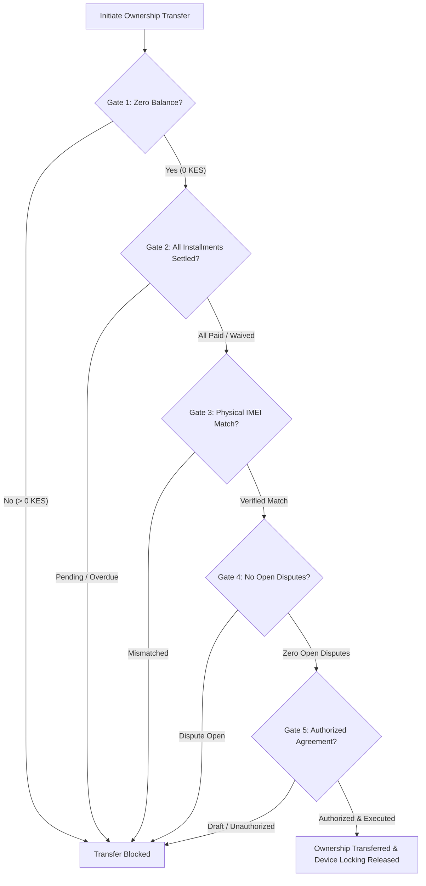

# Spectrum Credit Limited: Phone Lease Desk System

An end-to-end device financing, leasing desk, and double-entry ledger management system built for Kenyan smartphone micro-leasing operations.

[](js/uat.js)
[-blue)](#financial-math--ledger-specifications)
[](#luhn-15-check-digit-verification)
[](#safaricom-m-pesa-daraja-integration)

---

## 1. System Architecture

The project is structured with a dual-engine architecture:
1. **Interactive Client & Node.js Server Runtime**:
   - `index.html`: Fast, modular frontend shell with responsive UI, dark/light theme support, and tabular layout.
   - `css/app.css`: Comprehensive design system with responsive breakpoints, metric cards, status badges, and accessibility styling.
   - `js/data.js`: System roles, permissions matrix, document types, standard lease clauses, and product catalogue.
   - `js/ledger.js`: Financial math (integer cents), Luhn-15 IMEI generator & validator, equal-installment schedule builder.
   - `js/engine.js`: Complete business rules engine (credit assessment, digital agreements, IMEI allocation, double-entry ledger, daily lifecycle scheduler, disputes & waivers).
   - `js/app.js`: UI controller handling reactive state, role switching, search, dialogs, and real-time clock.
   - `scripts/build.js`: Automated build verification and test runner script.
   - `server.js`: Node.js HTTP server providing static hosting, REST endpoints, and M-PESA Daraja webhook simulation (zero external dependencies).
2. **PHP Backend Architecture (`php/`)**:
   - `php/autoload.php`: PSR-4 class autoloader for `SpectrumCredit` namespace.
   - `php/database/schema.sql`: Relational SQLite DDL schema with foreign key constraints and performance indices.
   - `php/database/Database.php`: SQLite PDO singleton connection manager with auto-migration.
   - `php/database/Seed.php`: Database seeder for products, pricing matrices, and inventory devices.
   - `php/models/`: Active-record models (`Customer`, `Product`, `Pricing`, `Device`, `Application`, `Agreement`, `Lease`, `Installment`, `Payment`, `LedgerEntry`, `AuditLog`).
   - `php/services/`: Core domain services (`LeaseEngine.php`, `AssessmentService.php`, `LedgerService.php`, `MpesaService.php`).
   - `php/controllers/`: REST API controllers (`ApplicationController.php`, `LeaseController.php`, `PaymentController.php`, `WebhookController.php`).
   - `php/index.php`: Front controller & API router for `php -S 127.0.0.1:8000 -t php`.

---

## 2. Directory Layout

```
.
├── index.html                   # Clean frontend application entry point
├── package.json                 # Node manifest with test and start scripts
├── scripts/
│   └── build.js                 # Verification and build pipeline
├── server.js                    # Zero-dependency Node.js HTTP server & API
├── css/
│   └── app.css                  # Responsive design system & CSS variables
├── js/
│   ├── data.js                  # Roles, clauses, and catalogue data
│   ├── ledger.js                # Money math (KES cents), Luhn-15, schedule builder
│   ├── engine.js                # Core business engine & double-entry ledger
│   └── app.js                   # UI controller, routing, role switcher, modals
└── php/
    ├── autoload.php             # PSR-4 autoloader
    ├── index.php                # PHP API router & front controller
    ├── database/
    │   ├── Database.php         # PDO SQLite singleton & migration runner
    │   ├── Seed.php             # Database seeder
    │   ├── schema.sql           # SQLite schema DDL
    │   └── spectrum.sqlite      # SQLite database file (auto-generated)

    ├── models/
    │   ├── Model.php            # Base Active-Record style model
    │   ├── Customer.php
    │   ├── Product.php
    │   ├── Pricing.php
    │   ├── Device.php
    │   ├── Application.php
    │   ├── Agreement.php
    │   ├── Lease.php
    │   ├── Installment.php
    │   ├── Payment.php
    │   ├── LedgerEntry.php
    │   └── AuditLog.php
    ├── services/
    │   ├── AssessmentService.php # Credit scoring & policy hard stops
    │   ├── LedgerService.php    # Double-entry ledger postings
    │   ├── MpesaService.php     # Daraja STK Push & C2B reconciliation
    │   └── LeaseEngine.php      # Full business lifecycle & 5-gate check
    ├── controllers/
    │   ├── ApplicationController.php
    │   ├── LeaseController.php
    │   ├── PaymentController.php
    │   └── WebhookController.php
```

---

## 3. The 13 Business Roles & Segregation of Duties

The system enforces strict **Segregation of Duties (SoD)** across 13 business roles:

| Role | Primary Responsibilities | Strict Control Invariants |
| :--- | :--- | :--- |
| **Agent** | Customer onboarding, application capture, document upload | Cannot approve applications; cannot authorize agreements |
| **Credit Analyst** | Credit score review, affordability check | Cannot approve applications exceeding limit; cannot approve own application |
| **Credit Manager** | Final credit approvals up to high limit | Cannot approve applications they authored |
| **Head of Credit** | Policy exception approvals, high-value overrides | Approvals audited with mandatory justification |
| **Legal Officer** | Contract clause configuration, regulatory compliance | Reviews customer signatures prior to execution |
| **Inventory Clerk** | Stock receipt, device intake, IMEI scanning | Can only allocate devices verified via Luhn check |
| **Technician** | Device diagnostics, lock profile provisioning, handover | Enforces handover only after deposit is cleared |
| **Collections Officer** | Delinquency tracking, customer outreach, payment plans | Cannot waive balances without Manager approval |
| **Collections Lead** | Hard arrears escalation, repossession authorization | Authorizes field recovery workflows |
| **Customer Care** | Inquiries, payment reconciliation, disputes intake | Cannot issue financial adjustments directly |
| **Finance Officer** | General ledger postings, daily bank reconciliations | Double-entry balancing strictly enforced |
| **Finance Manager** | Financial adjustments, waiver and refund approvals | Cannot approve requests originated by themselves |
| **Super Admin** | User access management, audit log inspection | System configuration and emergency maintenance |

### Core Segregation Invariants:
1. **Application Creator $\neq$ Application Approver**: An Agent or Analyst who submits an application cannot participate in its approval.
2. **Agreement Creator $\neq$ Agreement Authorizer**: The person who drafts or issues an agreement cannot be the sole authorizer executing it.
3. **Adjustment Requester $\neq$ Adjustment Approver**: Customer Care or Collections officers requesting a fee waiver or refund cannot approve that adjustment.
4. **No Manual Cash Payment Override**: Payments must originate from verified M-PESA receipts (STK Push callback or C2B Paybill validation).

---

## 4. Financial Math & Ledger Specifications

### 4.1. Integer Cents Representation
To eliminate IEEE-754 floating point rounding errors in financial transactions:
- All currency calculations are executed in **integer cents** ($1\text{ KES} = 100\text{ cents}$).
- Example: $\text{KES } 20,500.00$ is represented internally as `2050000`.

### 4.2. Installment Schedule & Residual Cent Allocation
When dividing the principal balance across $N$ installments:
$$\text{Principal} = \text{Total Lease Price} - \text{Deposit}$$
$$\text{Base Installment} = \lfloor \text{Principal} / N \rfloor$$
$$\text{Final Installment} = \text{Principal} - (\text{Base Installment} \times (N - 1))$$
*Any residual cent due to non-integer division always lands on the final installment.*

### 4.3. Luhn-15 Check Digit Verification
IMEIs are 15-digit numbers whose final check digit is computed via the standard Luhn (mod 10) algorithm:
- Starting from index 0 (even positions in 0-indexed string), double the digit. If the result exceeds 9, subtract 9.
- Sum all digits across the first 14 positions.
- The 15th check digit $C$ satisfies:
$$C = (10 - (\text{Sum} \bmod 10)) \bmod 10$$
*Invalid or non-conforming IMEIs are rejected at device intake and allocation.*

### 4.4. Double-Entry General Ledger Chart of Accounts
Every financial movement generates balanced debit and credit entries:

| Account Code | Account Name | Type | Typical Entries |
| :--- | :--- | :--- | :--- |
| `1010` | Cash / M-PESA Clearing | Asset | Debited when customer pays deposit or installment |
| `1200` | Lease Receivables | Asset | Debited on lease activation; Credited on installment receipt |
| `1300` | Device Inventory (At Cost) | Asset | Credited when physical device is released to customer |
| `2010` | Customer Deposits Liability | Liability | Credited upon initial deposit; Cleared upon lease activation |
| `2200` | Unearned Finance Revenue | Liability | Credited upon lease inception for total interest charge |
| `4010` | Finance Lease Revenue | Revenue | Recognized as earned over installment tenure |
| `5010` | Bad Debt & Waivers | Expense | Debited when fee waivers or balances are written off |

---

## 5. Safaricom M-PESA (Daraja) Integration

### 5.1. STK Push (Lipa na M-PESA Online)
1. Customer initiates deposit or installment payment.
2. System calls `/api/mpesa/stkpush` with MSISDN (`254XXXXXXXXX`), amount in KES, and account reference (`APP-XXX` or `LSE-XXX`).
3. System responds with `MerchantRequestID` and `CheckoutRequestID`.
4. Safaricom STK Push prompt appears on customer's phone requesting M-PESA PIN.

### 5.2. Webhook Callback Handling & Idempotency
- When Safaricom sends the `POST /api/mpesa/callback` payload:
  - If `ResultCode == 0`, extracts `MpesaReceiptNumber`, `Amount`, `PhoneNumber`, and `TransactionDate`.
  - Checks database for existing `MpesaReceiptNumber`. **Duplicate receipts are rejected immediately to prevent double-crediting.**
  - Allocates payment to outstanding installments in chronological due-date order.
  - Generates balanced double-entry ledger entries.

---

## 6. The 5-Gate Ownership Transfer Check

Ownership of the leased device can **only** be transferred to the customer when all five independent verification gates pass:



1. **Gate 1: Zero Balance** — `principal_balance == 0`.
2. **Gate 2: All Installments Settled** — Every installment is in `Paid` or `Waived` state.
3. **Gate 3: Physical IMEI Match** — Scanned physical IMEI strictly matches the allocated device's Luhn-verified IMEI.
4. **Gate 4: No Open Disputes** — Zero unresolved customer disputes on the lease account.
5. **Gate 5: Authorized Agreement** — Agreement status is `Authorized` or `Executed` with valid signatures on record.

---

## 7. Automated UAT Test Cases

The test suite covers 44 comprehensive acceptance test scenarios:

| Category | Test IDs | Coverage Highlights |
| :--- | :--- | :--- |
| **Catalogue & Pricing** | `TC-001` - `TC-005` | Active pricing lookup, fixed deposit calculation, percentage deposit calculation, draft price rejection |
| **Credit Assessment** | `TC-006` - `TC-011` | Underage hard stop, clean CRB scoring, active CRB default hard stop, affordability threshold, existing active lease limits |
| **Application & SoD** | `TC-012` - `TC-018` | Application creation, document verification, creator-approval blocking, role authorization limits |
| **Digital Agreement** | `TC-019` - `TC-023` | Mandatory clause insertion, customer digital signature, officer authorization, unauthorized handover blocking |
| **Inventory & IMEI** | `TC-024` - `TC-028` | Luhn-15 check digit algorithm, invalid check digit rejection, device stock allocation, duplicate IMEI prevention |
| **M-PESA & Payments** | `TC-029` - `TC-034` | STK Push payload structure, receipt uniqueness (idempotency), chronological installment allocation, overpayment handling |
| **Ledger Postings** | `TC-035` - `TC-039` | Balanced debit/credit entries on deposit, activation, installment receipt, and authorized waivers |
| **Ownership Transfer** | `TC-040` - `TC-044` | The 5-gate ownership transfer validation (balance, installment status, IMEI verification, dispute check, executed agreement) |

---

## 8. How to Run the Application

### Option A: Node.js Server (Recommended for immediate execution)
Requirements: Node.js v18+ (tested on Node v20.15.1).

```bash
# 1. Start the HTTP and API server
npm start

# Access the desk interface at:
# http://127.0.0.1:3000

# 2. Run the 44 automated UAT test cases
npm test
```

### Option B: PHP Server & SQLite Backend
Requirements: PHP 8.1+ with `pdo_sqlite` enabled.

```bash
# 1. Start the PHP server
npm run php:serve
# (or directly: php -S 127.0.0.1:8000 -t php)

# 2. Run the PHP test runner
npm run php:test
# (or directly: php php/tests/UatTests.php)
```

### Option C: Standalone In-Browser
You can also open `index.html` directly in any modern web browser (Chrome, Safari, Firefox, Edge). All business rules, client-side persistence, role switching, and UAT test running operate in full offline mode without any external build step or server dependency.
